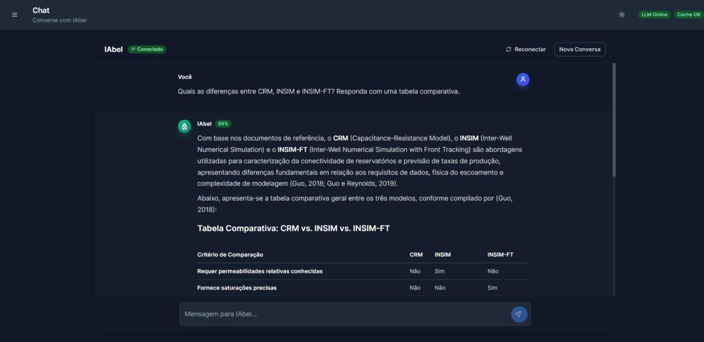
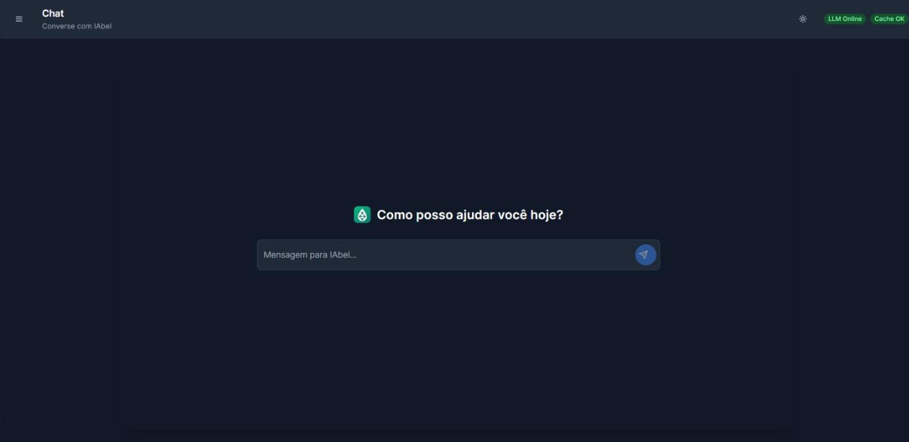

<div align="center">
  

  # IAbel — RAG Assistant for Reservoir Engineering

  **Answers technical questions about petroleum reservoir engineering from theses, papers and manuals, in Portuguese, citing its sources as (Author, Year).**

  [](https://python.org)
  [](https://fastapi.tiangolo.com)
  [](https://react.dev)
  [](https://typescriptlang.org)
  [](https://www.trychroma.com)
  [](#license)

</div>

---

## About

IAbel is a **Retrieval-Augmented Generation (RAG)** assistant built during doctoral research at PUC-Rio. It indexes the technical literature of a research group (dissertations, journal papers, simulator manuals and slide decks, in Portuguese and English) and answers questions grounded in those documents.

- **Multilingual retrieval:** `paraphrase-multilingual-mpnet-base-v2` places Portuguese and English text in the same vector space, so a question in Portuguese finds passages in English papers.
- **Cited answers:** every passage carries bibliographic metadata, and answers cite it inline as (Author, Year).
- **Where data goes:** extraction, embeddings and the vector index run locally. With Gemini as the LLM, the question and the retrieved passages are sent to the Gemini API; with Ollama, everything stays on your machine.

## Screenshots





---

## How it works

```
 Indexing (offline)                                   Question (online)
 ─────────────────                                    ─────────────────
 PDFs ─► text extraction & cleaning                   question
          (encoding, hyphenation, slide headers)         │
       ─► chunks of ~300 characters                      ▼
       ─► split to fit the 128-token model window     embedding (same model)
       ─► bibliographic metadata (catalog)               │
       ─► multilingual embeddings (768-d)                ▼
       ─► ChromaDB (cosine, deterministic IDs) ◄──── top-k most similar passages
                                                         │
                                                         ▼
                                           prompt = question + passages + citations
                                                         │
                                                         ▼
                                           LLM (Gemini API or Ollama), streamed
                                           answer in Portuguese, cited (Author, Year)
```

The web interface uses this pipeline (RAG v3). The backend also contains an earlier pipeline (v1/v2) with multi-query expansion and Reciprocal Rank Fusion, cross-encoder reranking and context compression, still reachable through the API.

## Features

| Feature | Description |
|---|---|
| **Cited answers** | Inline (Author, Year) citations from `backend/data/catalogo_bibliografico.json` |
| **Multilingual search** | Portuguese questions retrieve English and Portuguese passages |
| **Streaming** | Token-by-token answers over Server-Sent Events |
| **Rich rendering** | Markdown, tables and LaTeX equations (KaTeX) in the chat |
| **Idempotent indexing** | Deterministic chunk IDs; reindexing replaces the index instead of duplicating it |
| **Token-aware chunking** | Every chunk fits the embedding model's 128-token window |

---

## Tech Stack

**Backend:** FastAPI · ChromaDB · Sentence Transformers · Hugging Face Transformers · Google Gemini API / Ollama · PyMuPDF / pdfplumber · spaCy · LangChain (document loaders) · PEFT/LoRA (experiments)

**Frontend:** React 18 · TypeScript · Vite · Tailwind CSS · react-markdown + KaTeX · Zustand

---

## Installation and running

**Requirements:** Python 3.12, Node.js 18+, a [Google Gemini API key](https://ai.google.dev) (or a local [Ollama](https://ollama.com) install). Redis is optional; without it the backend uses an in-memory cache.

### Windows

1. `instalar_windows.bat` — installs Python 3.12 via [uv](https://docs.astral.sh/uv/), creates `backend\venv` from `backend\requirements-windows.txt` (CPU PyTorch) and installs the frontend.
2. Copy `backend\.env.example` to `backend\.env` and set `GOOGLE_API_KEY`.
3. `iniciar_windows.bat` — starts the backend (port 8000) and the frontend (port 3000).

### Linux / macOS

```bash
git clone https://github.com/lunatila/IAbel.git && cd IAbel
cp backend/.env.example backend/.env          # set GOOGLE_API_KEY
python3.12 -m venv backend/venv && source backend/venv/bin/activate
pip install torch==2.7.1 --index-url https://download.pytorch.org/whl/cpu
pip install -r backend/requirements-windows.txt   # pinned versions, not Windows-specific
cd frontend && npm ci && cd ..
python backend/run_windows.py                  # terminal 1: backend
cd frontend && npm run dev                     # terminal 2: frontend
```

Open http://localhost:3000 (API docs at http://localhost:8000/docs). The first start loads the embedding model and takes about a minute.

### Configuration (`backend/.env`)

| Variable | Default | Purpose |
|---|---|---|
| `GOOGLE_API_KEY` | — | Gemini API key |
| `GEMINI_MODEL` | `gemini-2.5-flash` | Each model has its own daily quota on the free tier |
| `GEMINI_THINKING_BUDGET` | `1024` | Reasoning tokens, added on top of the answer limit |

---

## Adding documents

1. Put the PDFs in `backend/data/pdfs/`.
2. Add each file to `backend/data/catalogo_bibliografico.json` (authors as `"Surname, Name"`, year, title). Files missing from the catalog get an automatically guessed citation.
3. Rebuild the index:

```bash
python scripts/index_pdfs_v3.py
```

> Known limitation: the upload button in the interface and `POST /reindex/` still feed the legacy v1/v2 index, so documents added that way do not appear in the interface's answers. Use the script above.

---

## Engineering notes

Problems found and fixed while making retrieval reliable:

- **75% duplicate chunks.** Reindexing never cleared the collection and chunk IDs embedded a timestamp, so every run appended a full copy (10,698 chunks, 2,716 distinct). Fixed with deterministic IDs and a clean rebuild.
- **Truncated embeddings.** The embedding model reads at most 128 tokens, and 37% of the 500-character chunks were longer, so their tail was invisible to search. Chunks are now ~300 characters and any chunk still over the limit is split using the model's own tokenizer.
- **Slide headers matching every question.** Short passages repeated on many pages (headers, title slides) are dropped at indexing time.
- **Wrong citations.** Author heuristics read cover pages ("THE GRADUATE SCHOOL") or file names; the bibliographic catalog now takes priority.
- **Mojibake and cut-off answers.** The Gemini stream has no charset and was decoded as ISO-8859-1; reasoning tokens consumed the output budget. Both fixed in `local_rag/models/gemini_client.py`.
- **Fine-tuning vs. RAG.** A LoRA fine-tuning experiment on a GPT-2-family model (`backend/fine_tuning/`) gave worse answers than RAG and was not pursued.

---

## Project structure

```
IAbel/
├── backend/
│   ├── app/                    # FastAPI server (main.py) and RAG service
│   ├── data/
│   │   ├── pdfs/               # source documents (not versioned)
│   │   └── catalogo_bibliografico.json
│   ├── fine_tuning/            # LoRA experiments
│   └── run_windows.py          # backend launcher
├── frontend/src/components/    # chat, layout, dashboard, upload
├── local_rag/
│   ├── rag_v3_system.py        # pipeline used by the interface
│   ├── processors/             # PDF extraction and chunking
│   ├── embeddings/             # embedding model wrapper
│   ├── vectorstore/            # ChromaDB interface
│   ├── citations/              # metadata and citation formatting
│   └── models/                 # Gemini and Ollama clients
└── scripts/index_pdfs_v3.py    # builds the index
```

## API

```
POST /chat/stream/   streaming answer (SSE); body: {"message": "...", "mode": "rag_v3", "top_k": 4}
POST /upload-pdf/    upload a document (legacy v1/v2 index)
POST /reindex/       reindex all PDFs (legacy v1/v2 index)
GET  /status/        system status
GET  /health/        health check
POST /feedback/      rate an answer
```

Interactive documentation: http://localhost:8000/docs

---

## License

Academic and educational use. Developed as part of doctoral research at PUC-Rio.
